# SWS405 Digital Forensics, Assignment 2: MemLabs

**Name:** Pema Dolker       
**Student ID:** 02230294  
**Module tutor:** Pema Thinley  
**Semester:** Autumn 2026  

**Covered in this report:** Labs 1 to 5. 

Every lab section follows what the assignment asks for: the flags with labelled screenshots, my investigation log (dead ends included), and a short explanation in my own words. Screenshots are in the `evidence` folder of each lab, scripts are in `scripts`, and small output files I refer to are in `artifacts`.

---


## Setup
 
Kali Linux  with Volatility 2.6. `apt install volatility` was not available and apt was already broken , so I used the standalone Volatility 2.6 binary (`vol` in the commands I mention) and a git clone of Volatility for the one plugin the binary cannot load. `chromehistory` comes from `superponible/volatility-plugins`. `steghide` had to be installed from downloaded `.deb` files with `dpkg --force-depends`.
 
I assumed one Volatility profile for every image which cost me too much time. After that I ran `7z t` on every archive and `imageinfo` on every image first.
 
---
 

## Lab 1: Beginner's Luck
 
| Stage | Flag | Source |
|-------|------|--------|
| 1 | `flag{th1s_1s_th3_1st_st4g3!!}` | `consoles` output (Base64) |
| 2 | `flag{Good_BOY_good_girl_}` | raw pixels in the `mspaint.exe` process memory |
| 3 | `flag{w3ll_3rd_stage_was_easy}` | `flag3.png` inside `Important.rar` |
 
**Getting a usable image.** The first archive would not open in the file manager. In the terminal `7z t` gave `Data Error` and the extracted file was 808000657 bytes instead of 1073676288. I did not realise that at first. `imageinfo` still worked, but `pslist` failed with `Could not list tasks`, and `psscan` was empty. I tried other profiles, `kdbgscan`, the KDBG address and a second Volatility build, and all failed the same way, so the file had to be the problem. The Downloads copy had MD5 `79aedde9dcb00ef34c93206ef21e7cc7`, but the Lab 1 README lists `919a0ded944c427b7f4e5c26a6790e8d`. After a new download the archive passed `7z t` and the image MD5 was `b9fec1a443907d870cb32b048bda9380`, the value in the README. `pslist` then worked.
 
**Scoping.** `pslist` and `pstree` show Windows 7 SP1 x64, taken 2019-12-11 around 14:38 UTC. The user's processes are `cmd.exe` (1984, with `conhost.exe` 2692), `mspaint.exe` (2424), `WinRAR.exe` (1512) and `explorer.exe`. `DumpIt.exe` (796) started at 14:37:54, just before the capture, so it is the capture tool. This matches the lab story of a black window and someone drawing.
 
**Stage 1.** I ran `cmdscan` and `consoles`. `cmdscan` only shows the typed command `St4G3$1`. `consoles` also shows the screen buffer, and under `C:\Users\SmartNet>St4G3$1` there is a line of Base64, `ZmxhZ3t0aDFzXzFzX3RoM18xc3Rfc3Q0ZzMhIX0=`, which I decoded with `base64 -d`.
 
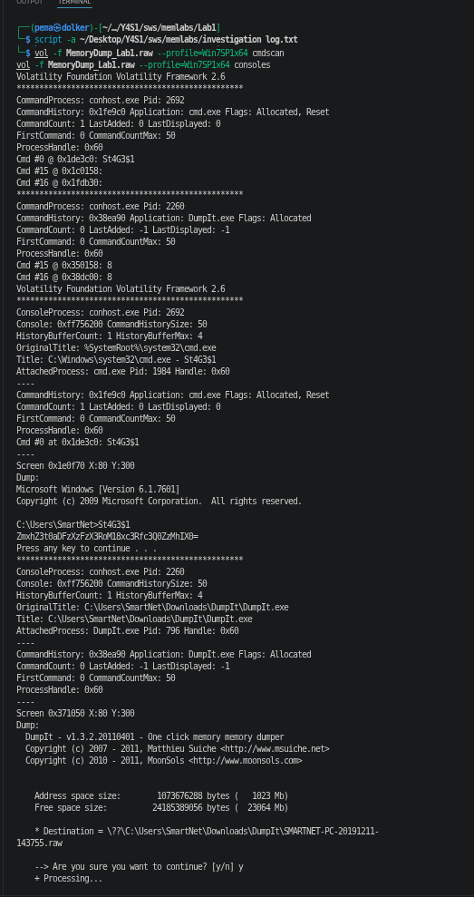
*Lab 1: cmdscan and consoles, Base64 line in the cmd.exe screen buffer*
 
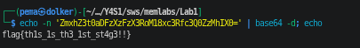   
*Lab 1, stage 1 flag: Base64 decode*
 
**Stage 3.** WinRAR was running, so I searched `filescan` for `rar` to find its archive and dumped it with `dumpfiles`. `Important.rar` is in `\Users\Alissa Simpson\Documents\` and appears three times (`0x3fa3ebc0`, `0x3fac3bc0`, `0x3fb48bc0`), which are separate file objects for the same file. The first one gave a valid RAR v5 file. `unrar` showed the comment "Password is NTLM hash(in uppercase) of Alissa's account passwd." `hashdump` gave Alissa Simpson's NTLM hash `f4ff64c8baac57d22f22edc681055ba6` (the fourth field). Administrator and Guest have the empty-password hash `31d6cfe0...`, so they are no use. In uppercase, `F4FF64C8BAAC57D22F22EDC681055BA6` extracted `flag3.png`.
 
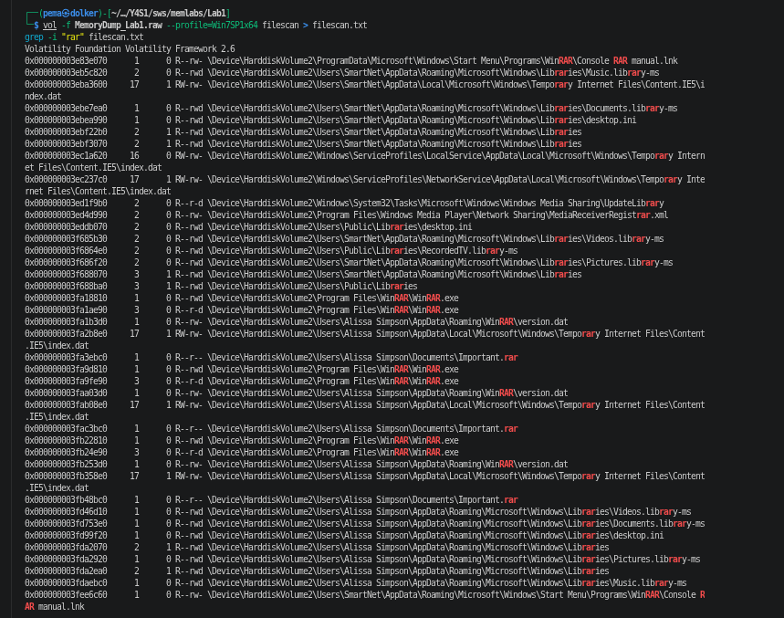   
*Lab 1: Important.rar found with filescan, three file objects*
 
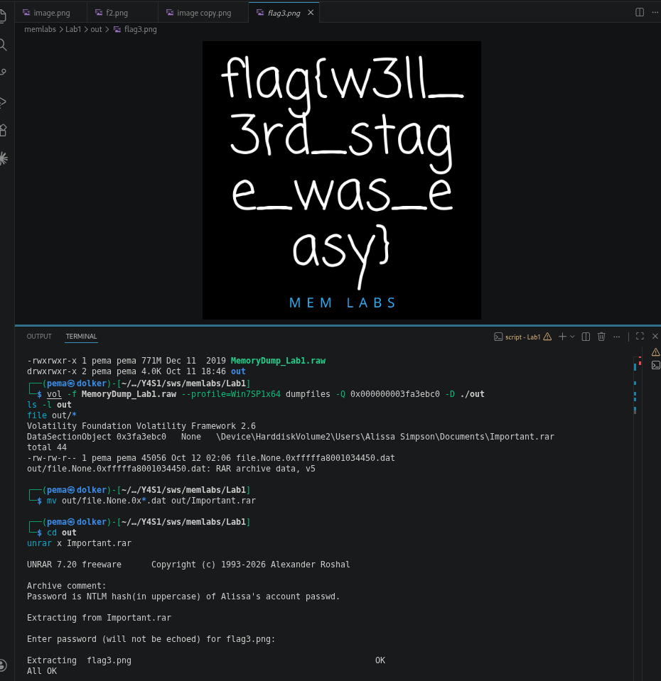   
*Lab 1: dumpfiles, unrar with the archive comment, flag3.png extracted*
 
  
*Lab 1, stage 3 flag: flag3.png*
 
**Stage 2.** The lab says she was trying to draw something, which points to `mspaint.exe` (PID 2424). I dumped its memory with `memdump -p 2424`, which gives a 266 MB file, so an unsaved drawing could be inside it. A drawing is pixels and not text, and my first attempts failed. `strings` only found Windows text, a search for PNG signatures found nothing, and showing the dump as pixels at one width gave mostly noise. I searched for long runs of white bytes (an empty canvas) and found five large blocks, but checking for a row width around them showed no clear picture. Then I treated the dump the way GIMP's raw image import does, with width, height and contrast. I wrote a small script that reads the bytes as 4 bytes per pixel, flips the image vertically and stretches the contrast, and saved contact sheets at widths 800, 1024, 1280, 1366 and 1440. In one of them handwriting appeared. It is repeated several times because the width is not exact, and it reads `flag{Good_BOY_good_girl_}`.
 
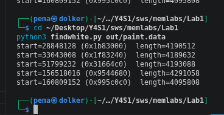   
*Lab 1: white runs found in the mspaint memory dump*
 
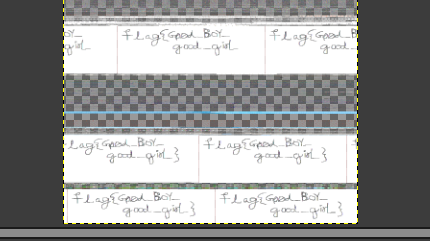   
*Lab 1, stage 2 flag: handwriting recovered from the raw pixels of mspaint.exe*
 
**Reasoning.** `consoles` worked because the console host (`conhost.exe`) keeps the whole screen buffer in memory. `cmdscan` only holds the typed input, and the Base64 string was output, which is why only `consoles` showed it. `filescan` finds file objects even for files that are not open, and `dumpfiles` rebuilds the file from pages cached in RAM, so I got the archive without disk access. `hashdump` reads the SAM and SYSTEM registry hives from memory and decrypts the stored hashes, so I had the NTLM hash without knowing the password. `memdump` copies the whole address space of a process, so a drawing that was never saved is still in it, as raw pixels at 4 bytes each. The picture only lines up when the width is right, and a wrong width shears it into noise, which is why I had to try several widths and stretch the contrast of the thin dark lines.
 
---
 
 
## Lab 2: A New World
 
| # | Flag | Source |
|---|------|--------|
| 1 | `flag{w3lc0m3_T0_$T4g3_!_Of_L4B_2}` | `NEW_TMP` environment variable (Base64) |
| 2 | `flag{w0w_th1s_1s_Th3_SeC0nD_ST4g3_!!}` | KeePass database, Recycle Bin |
| 3 | `flag{oK_So_Now_St4g3_3_is_DoNE!!}` | `Important.zip` from a Mega link in Chrome history |
 
**Getting a usable image.** My first download failed `7z t` with `Data Error` and the extracted file was only 4.8 MB. `imageinfo` gave "No suggestion" and `pslist` said "No suitable address space mapping found". After Lab 1 I recognised this as a broken file, not a wrong profile, so I downloaded it again. The new archive extracted with `Everything is Ok` and the image is 1073676288 bytes (archive MD5 `75d2ee1fcf2bc8a25329723e6ce2be93`, image MD5 `ddb337936a75153822baed718851716b`).
 
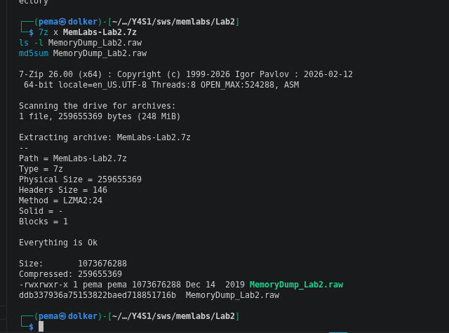
*Lab 2: archive extracted with 7z, image is 1073676288 bytes*
 
 
**Scoping.** Windows 7 SP1 x64. `chrome.exe` (parent PID 2296) and `KeePass.exe` (3008) stand out. There is also `notepad.exe` (3260) and `DumpIt.exe` (3844), the capture tool.
 
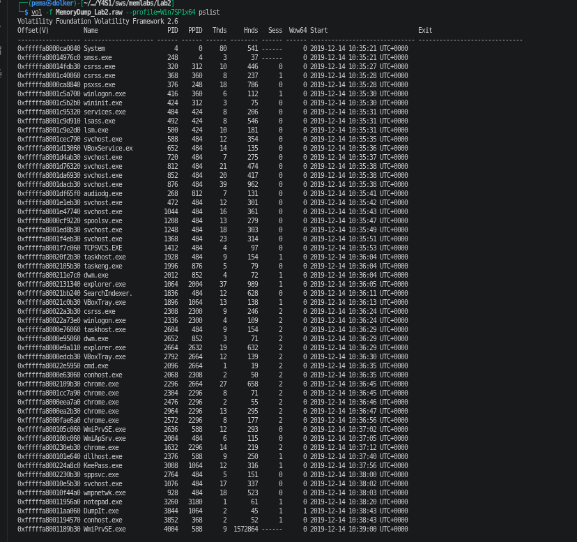
*Lab 2: pslist, Chrome and KeePass running, DumpIt at the end*
 
**Flag 1.** The assignment says to check `envars` early. `NEW_TMP` appears in every process with a value of `C:\Windows\` followed by a long string, which is not a normal Windows variable. It uses only Base64 characters and starts with `Zmxh` (`flag` in Base64). I decoded it with `base64 -d`.
 
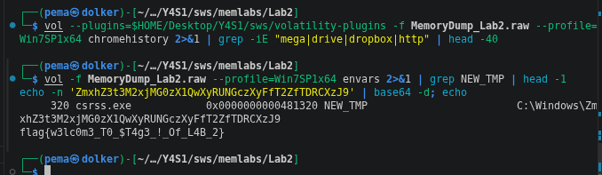
*Lab 2, Flag 1: NEW_TMP environment variable and its Base64 decode*
 
**The KeePass database.** `filescan | grep kdbx` found `\Users\SmartNet\Secrets\Hidden.kdbx` at `0x3fb112a0`. `dumpfiles` wrote a 4096 byte file that `file` calls a KeePass 2.x database.
 
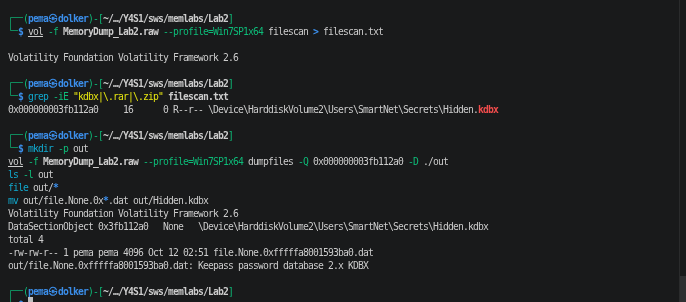
*Lab 2: Hidden.kdbx found with filescan and extracted with dumpfiles*
 
**The master password, first attempt.** In Lab 1 an NTLM hash was an archive password, so I tried the `hashdump` hashes of SmartNet and Alissa Simpson (upper and lower case) with a small `pykeepass` script.
 
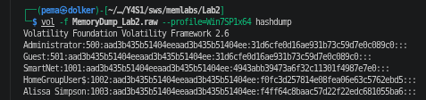  
*Lab 2: hashdump output, candidates for the KeePass master password*
 
All four runs crashed with `ValueError: Data must be padded to 16 byte boundary`. A wrong password gives a credentials error, so the file itself was damaged. `dumpfiles` writes whole 4 KB pages, so the real database is shorter than 4096 bytes with zeros after it. I cut it to 3422 bytes (the size without trailing zeros), and then all four hashes returned `CredentialsError`. So the file was fine and the hashes were not the password.
 
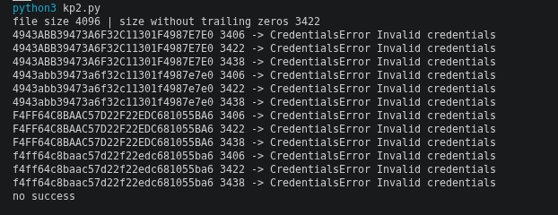
*Lab 2: database trimmed to 3422 bytes, all four NTLM hashes rejected*
 
**The real password.** I checked `cmdscan` and `consoles` (only a decoy, "Nothing here kids :)"), `clipboard` (empty) and the memory of notepad (nothing useful). Searching `filescan` for `pass` found `\Users\Alissa Simpson\Pictures\Password.png` at `0x3fce1c70`. I dumped it, and in tiny print in the corner it says "Psst!! password is P4SSw0rd_123".
 
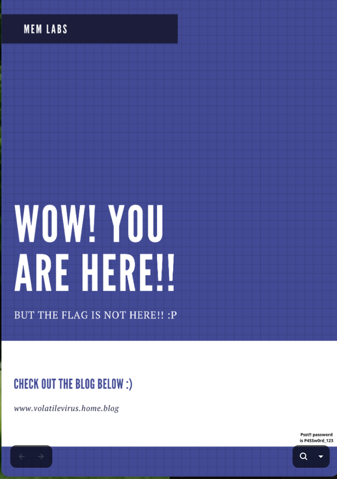
*Lab 2: Password.png recovered from memory, tiny print gives the master password*
 
**Flag 2.** With that password the database opened. The General group is full of decoys, and the Recycle Bin entry "Sabka Baap" has the flag as its password.
 
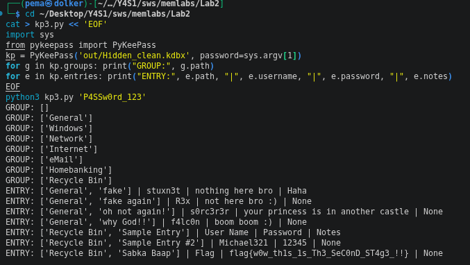
*Lab 2, Flag 2: KeePass opened, flag in the Recycle Bin*
 
**Chrome history.** With the standalone binary, `chromehistory` printed `You must specify something to do`, which means the plugin did not load. Using the git copy of Volatility with `--plugins` worked, and the history has a Mega folder link, `https://mega.nz/#F!TrgSQQTS!H0ZrUzF0B-ZKNM3y9E76lg`. `strings` on the image found the same URL.
 
**Flag 3.** The Mega folder has `Important.zip`, and its archive comment says: "Password is SHA1(stage-3-FLAG) from Lab-1. Password is in lowercase." The Lab 1 stage 3 flag is `flag{w3ll_3rd_stage_was_easy}`:
 
```bash
echo -n 'flag{w3ll_3rd_stage_was_easy}' | sha1sum | cut -d' ' -f1
# 6045dd90029719a039fd2d2ebcca718439dd100a
```
 
Plain `unzip` failed with `unsupported compression method 99` (AES encryption), and `7z` opened it.
 
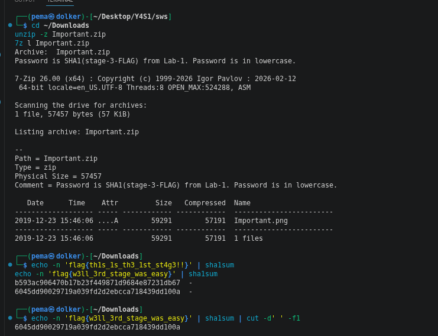  
*Lab 2: zip comment gives the password rule, SHA1 of the Lab 1 stage-3 flag*
 
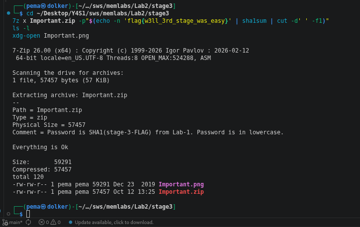  
*Lab 2: Important.zip extracted with 7z using the SHA1 password*
 
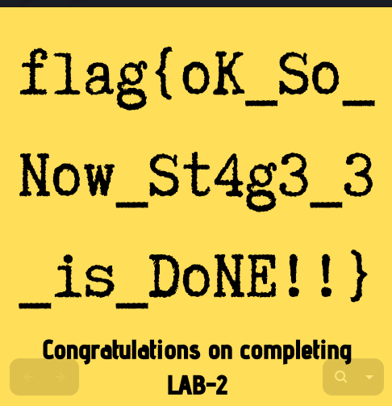  
*Lab 2, Flag 3: Important.png*
 
**How I derived the final password.** The zip comment says SHA1 of the stage 3 flag from Lab 1, lowercase. I took the exact string `flag{w3ll_3rd_stage_was_easy}` from Lab 1's `flag3.png`, hashed it with SHA1 using `echo -n` so no newline was included, and used the 40 character lowercase hex digest `6045dd90029719a039fd2d2ebcca718439dd100a`.
 
**Reasoning.** `envars` reads each process's environment block from memory, so a variable that every process shares stands out. For the database, `dumpfiles` rebuilds files in whole pages, which is why I had to trim the zero padding before it would parse. The master password was in a different file in the same user's profile, so it helps to check files around the target. The padding error followed by the credentials error is how I worked out the file was fine and only the password was wrong.
 
---
 
## Lab 3: The Evil's Den
 
**Flag:** `inctf{0n3_h4lf_1s_n0t_3n0ugh}` (first half from the script output, second half from steghide)
 
**Profile.** I assumed `Win7SP1x64` again, and `pslist`, `cmdscan` and `consoles` failed with "No valid DTB found". `imageinfo` suggests `Win7SP1x86_23418`, so it is a 32-bit image, and with that profile `pslist` works. The image is 1048510464 bytes (MD5 `ce4e7adc4efbf719888d2c87256d1da3`).
 
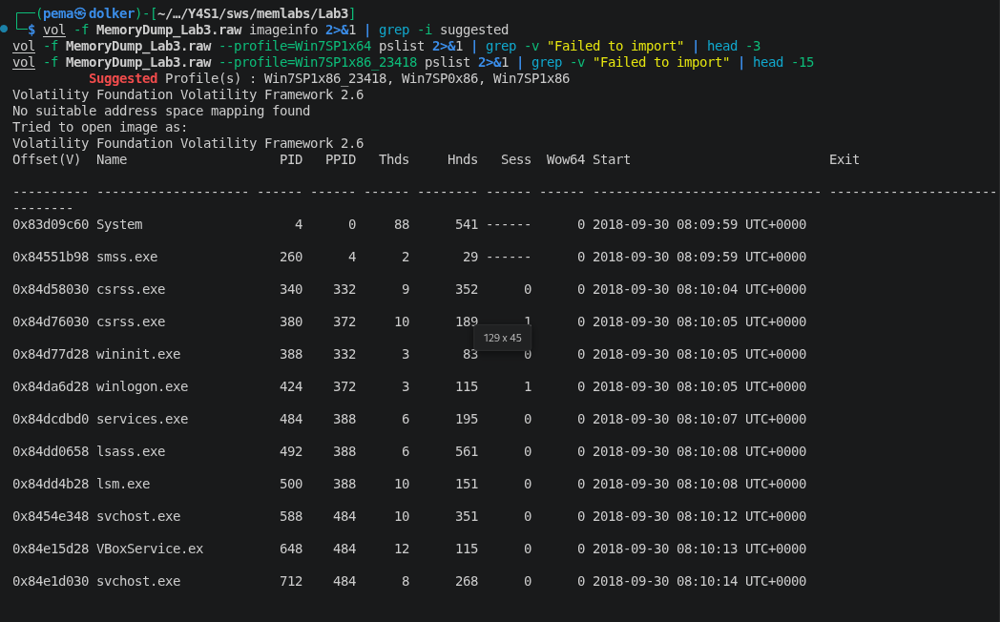
*Lab 3: x64 profile fails, imageinfo suggests a 32-bit profile and pslist works*
 
**Finding the files.** `filescan | grep` for `.py` and `.txt` was buried under the Python 2.7 install, so I filtered on the user's Desktop (`grep -iE "Users.hello.Desktop"`). There are three files: `evilscript.py.py` (`0x3de1b5f0`), `vip.txt` (`0x3e727e50`) and `suspision1.jpeg` (`0x04f34148`, the only image and the one with the misspelled name). I dumped all three with `dumpfiles` and used `file` to tell the generic output names apart. The text files have zero padding, so I viewed them with `tr -d '\000'`.
 
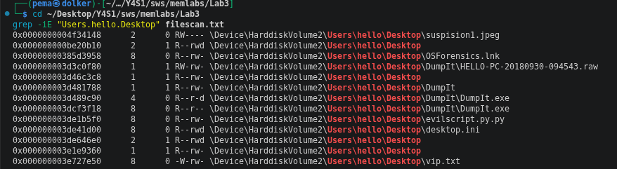
*Lab 3: script, output file and the oddly named image on the user's Desktop*
 
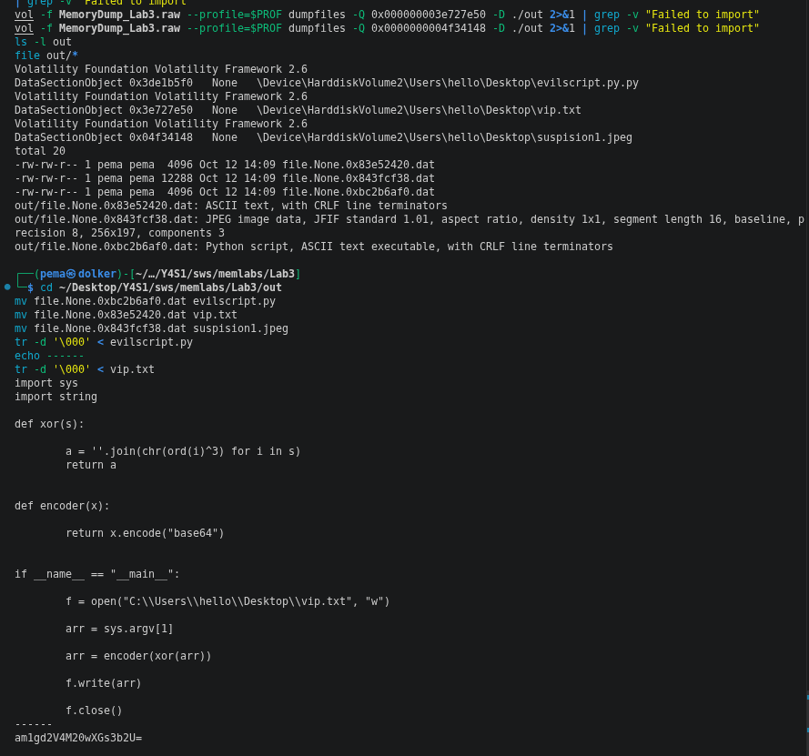
*Lab 3: files dumped, script source and vip.txt*
 
**The script.** I read it before running anything. It XORs every character of its input with 3, Base64 encodes the result and writes it to `vip.txt`, which contains `am1gd2V4M20wXGs3b2U=`. To undo it I reverse the order, Base64 decode first and then XOR with 3 again:
 
```python
import base64
data = open('vip.txt').read().strip()
step1 = base64.b64decode(data)
print(''.join(chr(b ^ 3) for b in bytearray(step1)))
```
 
The output is `inctf{0n3_h4lf`, the first half.
 
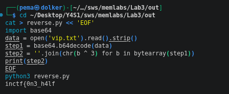   
*Lab 3: reverse.py output, first half of the flag*
 
**Steganography.** The first half is the steghide passphrase for the JPEG: `steghide extract -sf suspision1.jpeg -p 'inctf{0n3_h4lf'`. It extracts a text file containing `_1s_n0t_3n0ugh}`, and joined with the first half this gives the full flag.
 
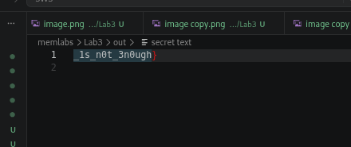   
*Lab 3: extracted file with the second half of the flag*
 
**What the script does and how I reversed it.** The script XORs each character's code with 3, Base64 encodes the result and writes it to `vip.txt`. XOR with the same key undoes itself, `(A ^ 3) ^ 3 = A`, so I did not need to find a key. I only reversed the steps in the opposite order, Base64 decode and then XOR 3 on each byte. The result is also the steghide passphrase, so the two halves depend on each other.
 
**Reasoning.** `filescan` finds file objects in memory even when no process points to them, which is how the script and its output on the Desktop turned up. `dumpfiles` recovers them from cached pages, but with page padding. Reading the script first showed the transformation, and the rest was undoing two steps. The wrong profile at the start taught me to check `imageinfo` for each image.
 
---
 
## Lab 4: Obsession
 
**Flag:** `inctf{1_is_n0t_EQu4l_7o_2_bUt_th1s_d0s3nt_m4ke_s3ns3}`
 
**Scoping.** `imageinfo` suggested `Win7SP1x64` first, with `Win2008R2SP1x64` among the variants. `pslist` works with `Win2008R2SP1x64`, so I kept it. The image is from 2019-06-29. `DumpIt.exe` (2624) is the capture tool, and `StikyNot.exe` (2432) is Sticky Notes, which I noted but did not need.
 
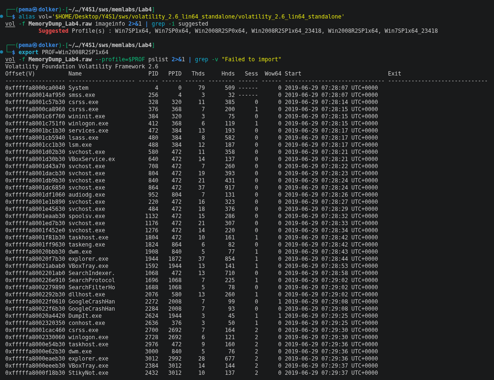
*Lab 4: imageinfo and pslist*
 
**Desktop files.** `filescan | grep -i Desktop` shows `galf.jpeg` (`0x3e8ad250`) and `Screenshot1.png` (`0x3e8d19e0`) in `eminem\Desktop`, and `Important.txt` (`0x3fc398d0`) in `SlimShady\Desktop`.
 
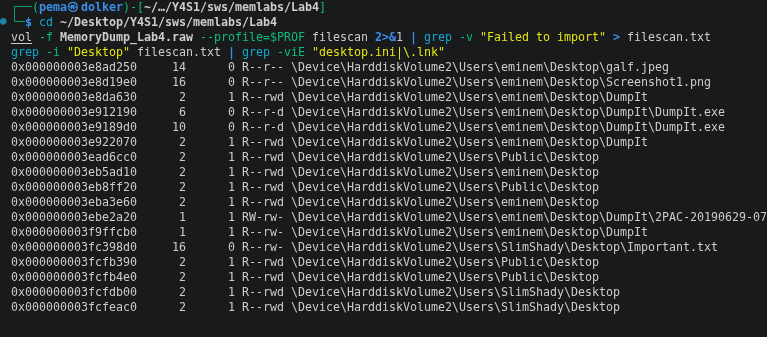
*Lab 4: images and Important.txt on the user Desktops*
 
**The images, a dead end.** I dumped both images. `galf.jpeg` is a picture of the Joker and `Screenshot1.png` is a screenshot. `exiftool` warned about trailer data after the PNG's `IEND` chunk, so I saved the extra data as `trailer.bin` (3601 bytes) and `jpeg_trailer.bin` (742 bytes). `file` only says `data` for both and `strings` finds nothing readable. `LMAO.txt` from the same check says "Move on bro, there is nothing here :)". So the images are a distraction. I still kept it in the log because it rules the images out.
 
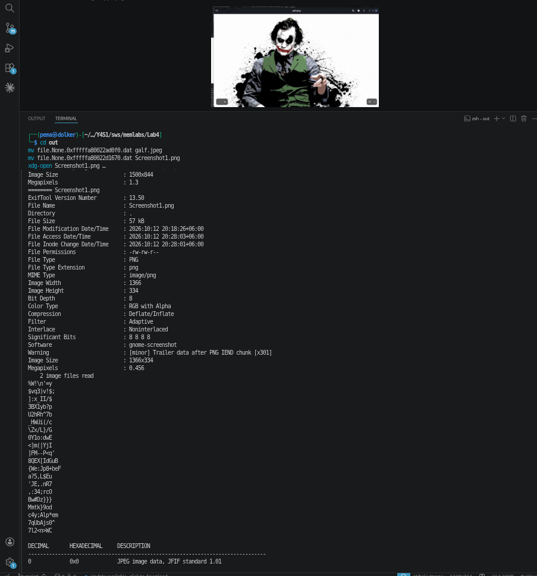
*Lab 4: exiftool and strings on the images*
 
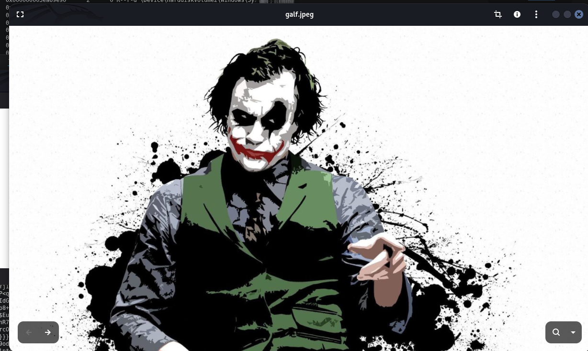
*Lab 4: galf.jpeg opened, a distractor*
 
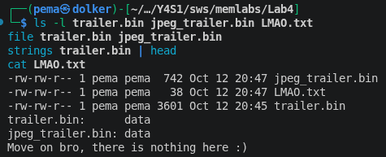   
*Lab 4: trailer data checked, nothing readable*
 
**`dumpfiles` on `Important.txt`.** `dumpfiles -Q 0x000000003fc398d0` prints the file object line, but the output folder stays empty (`total 0`). The file is listed by `filescan` and still cannot be extracted.
 
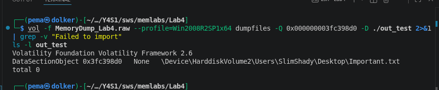
*Lab 4: dumpfiles finds the file object but writes no file*
 
**`mftparser`.** I ran `mftparser > mft.txt` and searched it for `Important.txt`. The record for `Users\SlimShady\Desktop\Important.txt` (record 26336, offset `0x3bddf000`) has its `$DATA` in the hex dump. The text is split into short pieces with runs of `0d 0a` between them (`i`, `n`, `ct`, `f{1`, `_is`, ...), ending with "Good work :P". I wrote a small script (`lab4/scripts/decode_mft.py`) that reads the hex bytes, removes the `\r\n` runs and decodes the rest.
 
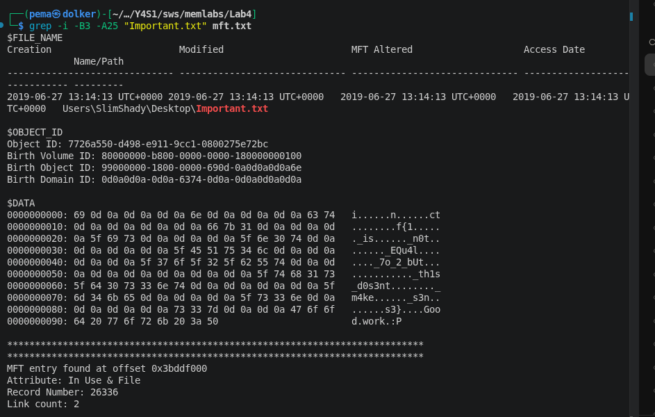
*Lab 4: Important.txt record and resident $DATA found by mftparser*
 
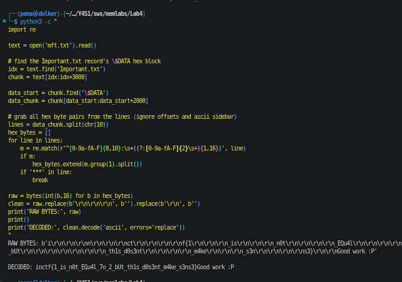
*Lab 4: script rebuilds the flag from the MFT hex dump*
 
**Why `dumpfiles` failed and `mftparser` worked.** `dumpfiles` can only rebuild a file from data pages that are cached in RAM, so a deleted file or a file whose pages were never loaded shows up in `filescan` but cannot be extracted. NTFS stores a very small file directly inside its MFT record as a resident `$DATA` attribute, and the MFT itself is cached in memory. `mftparser` reads those records, so it does not need the file's own pages. `Important.txt` is about 150 bytes, small enough to be resident.
 
---
 
## Lab 5: Black Tuesday
 
| # | Flag | Source |
|---|------|--------|
| 1 | `flag{!!_w3LL_d0n3_St4g3-1_0f_L4B_5_D0n3_!!}` | Base64 `.bmp` file name in IE history, also the archive password |
| 2 | `flag{W1th_th1s_$taGe_2_1s_c0mPL3T3_!!}` | `Stage2.png` inside the RAR |
 
**Scoping.** The image is 1073676288 bytes (MD5 `9dd6cb1134c9b018020bad44f27394db`). `imageinfo` suggests `Win7SP1x64` first, image date 2019-12-20. `WinRAR.exe` is PID 2924 (started 03:47:13), a child of `explorer.exe` 1580, the same parent as `DumpIt.exe` (2208).
 
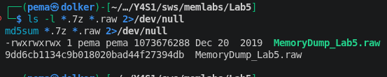
*Lab 5: image size and MD5*
 
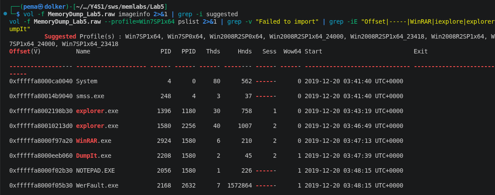
*Lab 5: imageinfo and pslist, WinRAR is PID 2924*
 
**The archive.** `grep -i "\.rar" filescan.txt` gives `\Users\SmartNet\Documents\SW1wb3J0YW50.rar` at `0x3eed56f0`. The name is Base64 for `Important`. `dumpfiles` gave a 77824 byte RAR v5 file, which I renamed `Important.rar`. `unrar` asks for a password straight away, and I did not try to guess it.
 
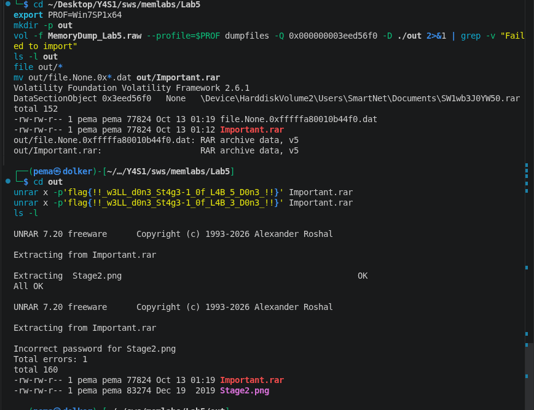
*Lab 5: RAR found with filescan, dumped, and both passwords tried*
 
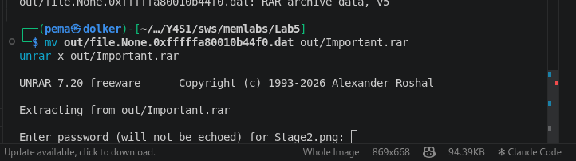
*Lab 5: archive is password protected*
 
**Browser history.** Nothing in the process list looked suspicious, so I moved to browser history and used the built-in `iehistory` plugin. My first run only wrote `ERROR: Invalid profile selected` into `ie.txt`, because `PROF` was empty in a new terminal. After `export PROF=Win7SP1x64` it produced 479 lines.
 
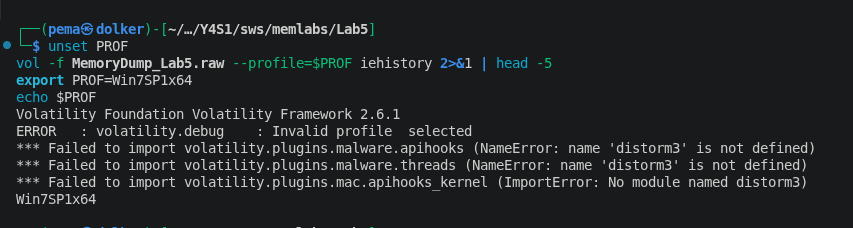
*Lab 5: first iehistory run fails because PROF was unset*
 
I sorted the `Location:` lines by length to find the odd ones. Most of the longest are Google redirects and Firefox download pages. The interesting ones are `file:///` entries visited by Alissa Simpson, with very long `.bmp` names, in her Pictures folder and in `C:\Windows\AppPatch\`. There are two versions that differ by one group of characters, and both start with `Zmxh` (`flag` in Base64):
 
- `flag{!!_w3LL_d0n3_St4g3-1_0f_L4B_5_D0n3_!!}`
- `flag{!!_w3LL_d0n3_St4g3-1_0f_L4B_3_D0n3_!!}`
The `L4B_5` one appears several times and the `L4B_3` one only once. Since this is Lab 5, I guessed the `5` one was real and tested both.
 
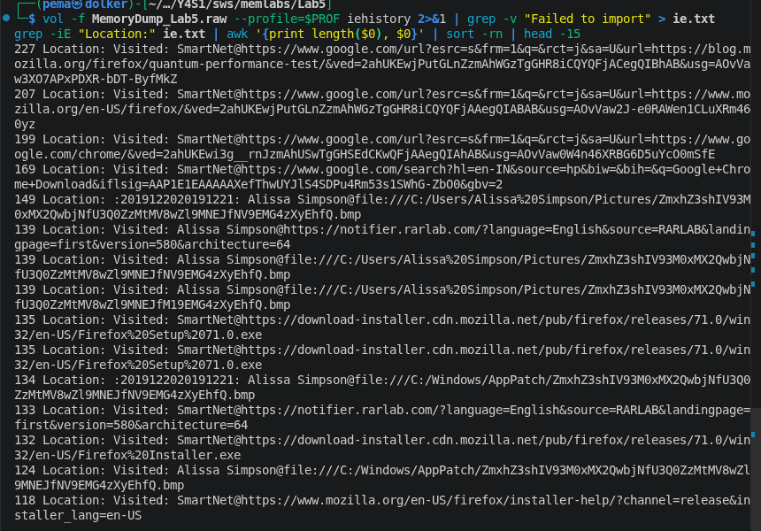
*Lab 5: iehistory lines sorted by length, encoded .bmp names*
 
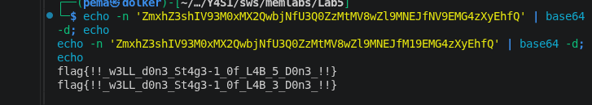
*Lab 5: both Base64 file names decoded*
 
**Opening the archive.** `unrar x -p'...L4B_5...' Important.rar` extracted `Stage2.png` with `All OK`. The `L4B_3` version gave `Incorrect password`.
 

*Lab 5: the L4B_5 string opens the archive, the L4B_3 one is rejected*
 
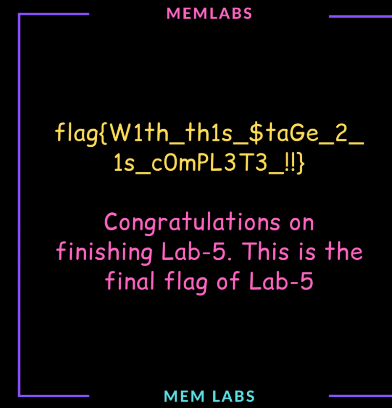
*Lab 5, Flag 2: Stage2.png*
 
**Plugin used.** I used `iehistory`, the built-in plugin for Internet Explorer, because the user was browsing with Internet Explorer (the history shows Chrome and Firefox download searches) and it keeps its history in `index.dat` files that this plugin parses. Lab 2 was Chrome, which needed the community `chromehistory` plugin.
 
**Reasoning.** `filescan` and `dumpfiles` gave me the archive, but the password was not in anything I could dump. It came from the browser history, where the user had opened files named with an encoded flag. I did not need `hashdump` because the credential was not a Windows account password. Two nearly identical names meant testing both before trusting one, and the real one has `L4B_5` in it, which matches the lab number.
 